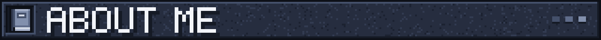
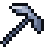
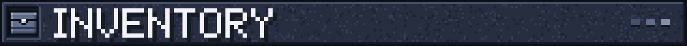
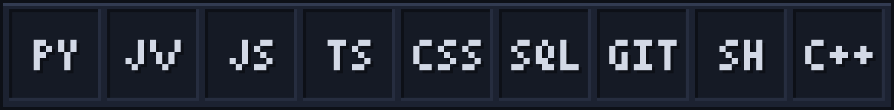
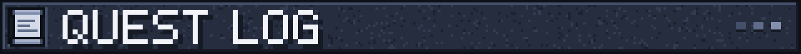
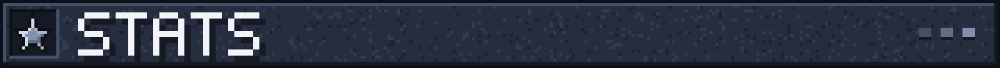
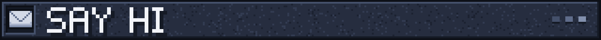
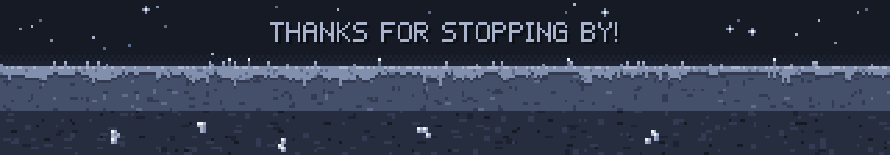

<!--
  Pixel-art profile README.
  Every image in /assets comes from generate.py. Edit CONFIG there, then run: python3 generate.py
  Accents: #8290ad and #44506a
-->

  
  

 

Hey, I'm **3vhy**. I build things one block at a time: small tools, side projects, and whatever idea won't leave me alone.

 &nbsp;**Currently mining:** a new side project 
 &nbsp;**Learning:** something new every week 
 &nbsp;**Ask me about:** code, games and pixel art 
 &nbsp;**Fun fact:** this whole page is hand-placed pixels 

 

  
   
  <b>PYTHON · JAVA · JAVASCRIPT · TYPESCRIPT · HTML &amp; CSS · SQL · GIT · BASH · C++</b>

 

- [x] Spawn into the world
- [x] Craft a first repository
- [ ] Ship a project people actually use
- [ ] Land a first open-source contribution
- [ ] Reach level 100

 

  

 

  
  
  

 

